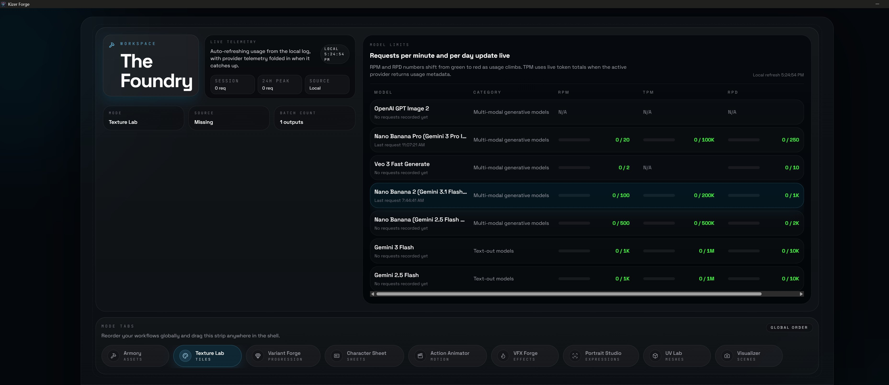
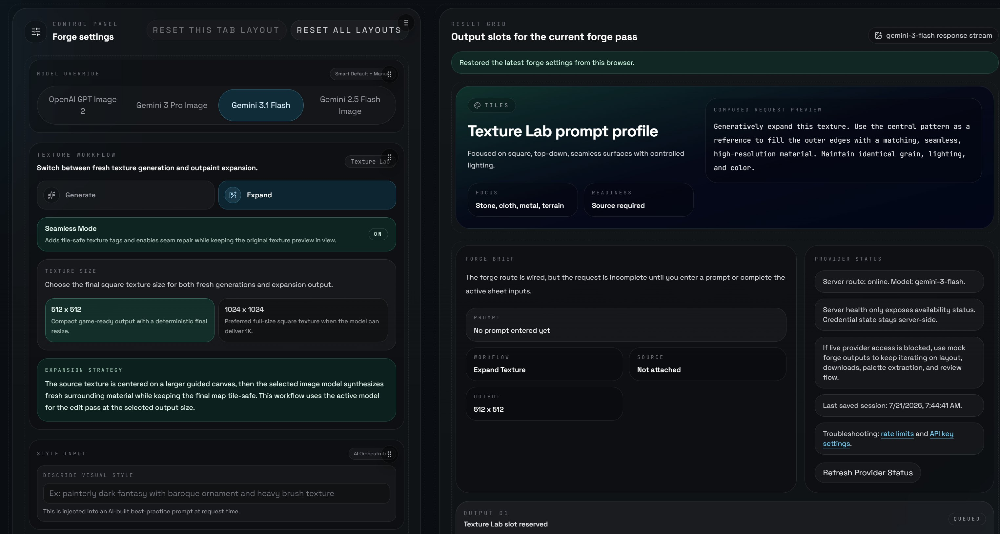
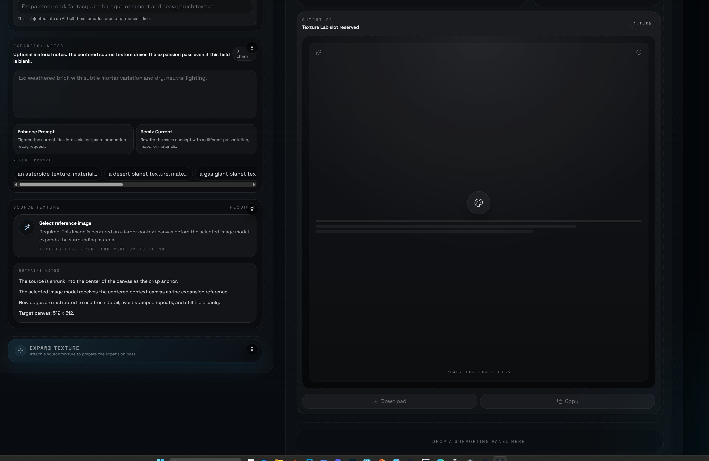

# The Foundry

The Foundry is a local Vite + React asset tool backed by an Express API and an optional Electron desktop shell. It is built for experimenting with image generation, character sheets, texture workflows, VFX texture/recipe output, UV tooling, and visual asset iteration.

This project is still early and very much open to improvement. If you try it, break it, fix it, or have ideas for making the workflows smoother, contributions are welcome.

## Screenshots







## Current Status

The main generation flows work, but a few areas need extra attention:

- The 3D viewer still needs work before that workflow feels reliable and polished.
- The Visualizer tab has not been thoroughly checked yet.
- Drag and drop works, but the implementation is not as clean or smooth as it should be.

## Requirements

- Node.js
- npm
- A Gemini API key for Gemini-backed generation
- Optional OpenAI credentials for OpenAI-backed image generation and telemetry

## Setup

Install dependencies:

```bash
npm install
```

Create a local environment file:

```bash
copy .env.example .env
```

Then fill in the keys you want to use:

```text
GEMINI_API_KEY=
OPENAI_API_KEY=
OPENAI_ADMIN_KEY=
OPENAI_ORGANIZATION_ID=
OPENAI_PROJECT_ID=
```

`.env` is intentionally ignored by git. Do not commit real API keys, auth tokens, signing certificates, local usage logs, or generated release builds.

## Development

Run the client and API server together:

```bash
npm run dev
```

If you want both processes in the current shell:

```bash
npm run dev:inline
```

## Desktop App

Launch the Electron desktop shell locally:

```bash
npm run desktop
```

This builds the frontend and opens The Foundry in a native desktop window with the Express API embedded inside the app process. The app icon is generated from `assets/branding/the-foundry-icon.jpg`.

You can also use the browser-app launcher:

```bash
npm run app
```

On Windows, a shortcut can point at:

```text
scripts\launch-desktop-hidden.vbs
```

That launcher will build the frontend if needed, start the local production server on `http://127.0.0.1:3001`, open the UI in an Edge/Chrome/Brave app window when available, and fall back to the default browser otherwise.

To force a specific browser executable, set `FOUNDRY_DESKTOP_BROWSER` before launch.

## Build A Portable EXE

Build a portable Windows executable with:

```bash
npm run build:exe
```

The packaged app is written to:

```text
release\
```

The executable looks for a `.env` file in these places, in this order:

- the project root during local development
- the packaged app resources directory
- the same folder as the built `.exe`

For distribution, copy `.env.example` to `.env` next to the packaged `.exe` and fill in your own keys. For cheaper OpenAI character-sheet runs, the default values in `.env.example` keep `OPENAI_CHARACTER_SHEET_QUALITY=low` and `OPENAI_CHARACTER_SHEET_REFERENCE_MAX_EDGE_PX=1024`.

## Windows Signing

The packaging flow is ready for standard Electron Builder code signing.

If you have a Windows code-signing certificate, set these environment variables before running `npm run build:exe`:

```text
WIN_CSC_LINK=path-or-base64-to-your-pfx
WIN_CSC_KEY_PASSWORD=your-pfx-password
```

Optional:

```text
REQUIRE_WINDOWS_SIGNING=true
```

With `REQUIRE_WINDOWS_SIGNING=true`, the build will fail instead of silently producing an unsigned executable. Without a signing certificate, Windows SmartScreen may warn when the `.exe` is opened on other machines.

## Commands

```bash
npm run build
npm run test
npm run lint
```

## Contributing

Issues and pull requests are welcome. The best places to help right now are Texture Lab, the 3D viewer, the Visualizer tab, drag-and-drop polish, tests around rough workflows, and clearer setup documentation.
